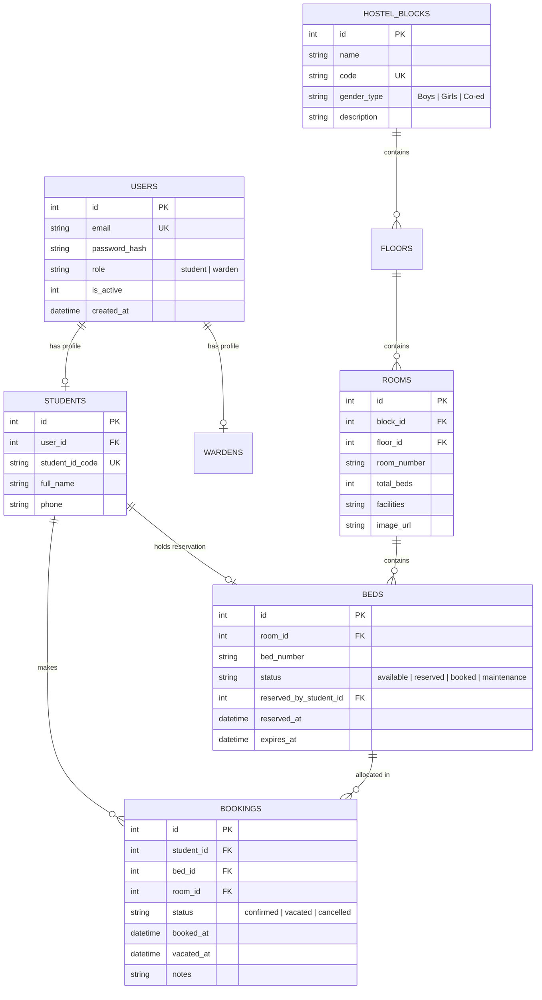
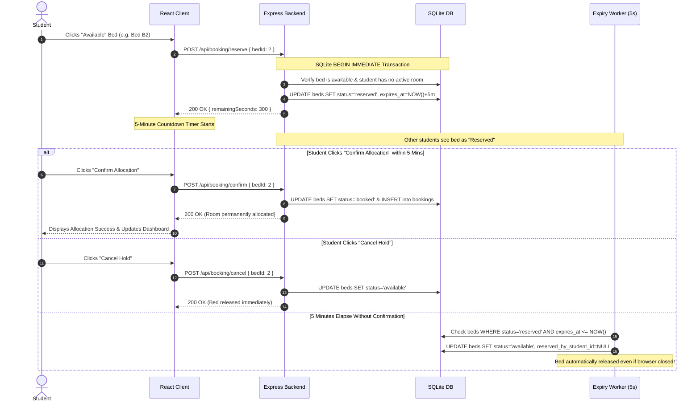

# 🏨 Hostel Room Allocation System (HostelSync)

> **B.Tech CSE Mini Project — Full-Stack Web Application**  
> Built with **React.js, Node.js, Express.js, SQLite, and Tailwind CSS**.  
> Runs completely self-contained in **Replit** and local environments without installing MySQL, Oracle, or external database engines.

---

## 📖 1. Project Introduction

The **Hostel Room Allocation System** is an enterprise-grade campus residential management portal engineered to streamline room and bed selection for university students while granting hostel wardens granular administrative control.

Unlike static prototypes, this application features a **fully working frontend, backend REST API, SQLite relational database, concurrency-safe bed locking, and complete operational workflows**.

### Core Problem Solved
Traditional hostel allotment suffers from room contention, manual paperwork, and double-booking errors. This system introduces an **atomic 5-minute temporary bed reservation lock**, automated background expiration workers, security CAPTCHAs, and verified email onboarding to deliver a first-come, first-served allocation experience.

---

## ⚡ 2. Key Features

### 👨‍🎓 Student Resident Module
* **Secure Registration**: Full Name, Student ID / Roll Number, Email, Phone, and bcrypt password hashing.
* **Email Verification with Local Demo OTP**: Generates a 6-digit OTP expiring in 5 minutes with a 60-second cooldown timer. Clearly displays a **Local Demo Mode** banner showing the generated code for immediate testing without third-party SMTP setup.
* **Security CAPTCHA**: Dynamic backend-generated mathematical challenges with single-use replay prevention.
* **Resident Dashboard**:
  * Welcome banner with Student Name, Roll Number, and active session details.
  * Real-time allocation card displaying Room Number, Bed Number, Hostel Block, Floor, Room Photo, Bed Photo, and Facilities.
  * Allocation history ledger tracking past stays and vacated dates.
  * One-click **Vacate Room** action with confirmation safety modal.
* **Browse Hostel Rooms & Bed Inspection**:
  * Filter by Hostel Block (e.g., Boys, Girls, Co-ed) and Floor level.
  * Real-time search by room number or amenities.
  * Room cards displaying photos, facility badges, and color-coded bed counters (Total, Free, Booked, Locked).
  * **Room & Bed Photo Showcase**: When a student opens a room, they see the high-resolution **Room Picture** and individual **Bed Pictures** for every bed in the room.
  * **Direct Book & Vacate Options**:
    * Available beds feature a direct **"Book & Lock This Bed"** option initiating the 5-minute atomic hold.
    * If the student is already allocated to a bed in this room, a direct **"Vacate My Bed"** option is provided right on the bed card.
* **5-Minute Bed Booking System**:
  * Interactive bed grid with visual bed photos, status badges, and zoom previews.
  * Clicking an available bed immediately engages an atomic 5-minute lock.
  * Live countdown timer with urgent color alerts when under 60 seconds.
  * Dual actions: **Confirm Allocation** (permanently books) or **Cancel Hold** (releases bed).
  * Concurrency guard preventing multiple students from locking the same bed simultaneously.

### 🛡️ Warden Administrative Module
* **Separate Warden Authentication**: Role-restricted login protected by CAPTCHA and bcrypt hashing.
* **Real-Time Warden Notifications**:
  * Real-time **Notification Bell** in the navbar with unread badge counter (auto-polled every 6s).
  * Immediate alerts whenever a student places a 5-minute bed hold, confirms an allocation, cancels a hold, or vacates a room.
  * Live Warden Alert Feed embedded directly on the Warden Dashboard.
  * Mark-as-read and clear-read options.
* **Room & Bed Picture Uploads**:
  * Warden can upload high-resolution **Room Pictures** via local image file picker or image URL.
  * Warden can upload individual **Bed Pictures** when adding or editing beds in any room.
* **Executive Summary Dashboard**:
  * 8 live metric cards: Total Students, Total Blocks, Total Rooms, Total Beds, Available Beds, Occupied Beds, 5-Min Reserved Beds, and Active Bookings.
  * Multi-segment occupancy progress bars per block.
  * Real-time audit log of recent room allocations and incoming alerts.
* **Manage Hostel Blocks**: Add, edit, or delete residential blocks (deletion strictly blocked if active residents or allocations exist).
* **Manage Floors & Rooms**:
  * Create new floors within blocks.
  * Add rooms with room number, capacity, facility checklists, description, and photo upload.
  * Delete rooms (safely guarded against occupied or reserved beds).
* **Manage Beds**:
  * Add individual beds to existing rooms with custom bed pictures.
  * Edit bed details and upload updated bed photos.
  * Toggle beds between **Available** and **Maintenance** out-of-service modes.
  * View assigned resident details (Name, Roll, Phone).
  * Force-release stuck or testing 5-minute temporary holds.
* **Student Directory**:
  * Search residents by Roll Number, Full Name, or Email.
  * View comprehensive student dossiers and complete historical room logs.
  * Activate / Deactivate student accounts on-demand.
* **Booking Ledger & Revocation**:
  * Complete audit trail filtered by block, room, and status (Confirmed, Vacated, Cancelled).
  * Administrative revocation modal with mandatory reason recording.
* **Real-Time Vacancy Report**:
  * Deep hierarchical breakdown: **Block &rarr; Floor &rarr; Room &rarr; Bed Chips**.
  * Instant color-coded vacancy visualization for physical hostel inspections.

---

## 🛠️ 3. Technology Stack

| Layer | Technology | Details |
| :--- | :--- | :--- |
| **Frontend** | React 18 & Vite | Fast reactive SPA with component-based modular structure |
| **Styling** | Tailwind CSS & Lucide Icons | Responsive modern college portal UI with clean color palettes |
| **Backend** | Node.js & Express.js | Structured REST API with middleware architecture |
| **Database** | SQLite (`node:sqlite` / WAL mode) | Zero-install, file-based relational DB with ACID transactions |
| **Authentication** | JWT & bcryptjs | Secure password hashing (10 salt rounds) and token auth |
| **Verification** | Custom OTP & CAPTCHA Engine | Server-side validation with single-use challenges and cooldowns |
| **Concurrency** | SQLite `BEGIN IMMEDIATE` | Race-condition prevention for simultaneous bed bookings |

---

## 📂 4. Project Folder Structure

```
hostel-allocation-system/
├── package.json               # Root scripts (start, dev, build, seed, test)
├── .replit                    # Replit cloud deployment and execution configuration
├── README.md                  # Comprehensive technical documentation
│
├── server/                    # Node.js & Express Backend
│   ├── package.json           # Server dependencies
│   ├── server.js              # Server entry point, middleware, static client serving
│   ├── test-api.js            # Automated backend integration test suite
│   ├── database/
│   │   ├── db.js              # SQLite initialization, schema creation & query helpers
│   │   ├── seed.js            # Seed data (demo warden, sample students, blocks, rooms, beds)
│   │   └── hostel.sqlite      # SQLite database file (auto-generated on boot)
│   ├── middleware/
│   │   └── auth.js            # JWT verification & role authorization (Student vs Warden)
│   ├── routes/
│   │   ├── auth.js            # Login, registration, OTP send/verify, forgot-password
│   │   ├── captcha.js         # Math CAPTCHA puzzle generation & verification
│   │   ├── hostel.js          # Public/browsing routes for blocks, floors, rooms
│   │   ├── booking.js         # 5-min bed reservation, confirmation & cancellation
│   │   ├── student.js         # Student profile, dashboard & room vacating
│   │   └── warden.js          # Admin blocks, rooms, beds, students & vacancy reports
│   └── utils/
│       ├── captcha.js         # Arithmetic challenge generator and single-use validator
│       ├── otp.js             # 6-digit OTP generator with cooldown & demo mode banner
│       └── expiryWorker.js    # Background interval worker releasing expired 5-min holds
│
└── client/                    # React.js Frontend (Vite)
    ├── package.json           # Client dependencies
    ├── vite.config.js         # Vite configuration with API reverse proxy
    ├── tailwind.config.js     # Tailwind CSS theme styling
    ├── index.html             # HTML5 entry with Google Fonts
    └── src/
        ├── main.jsx           # React DOM root entry
        ├── App.jsx            # View routing, navigation state & role guards
        ├── index.css          # Tailwind base directives & custom scrollbars
        ├── api/
        │   └── index.js       # Centralized REST API client & localStorage auth helpers
        ├── context/
        │   └── AuthContext.jsx# Global authentication context (user, token, roles)
        ├── components/
        │   ├── Navbar.jsx     # Navigation bar with role badges and portal switcher
        │   ├── Modal.jsx      # Reusable accessible dialog modal with backdrop blur
        │   ├── Toast.jsx      # Toast notification system (success, error, info)
        │   ├── CaptchaInput.jsx# Visual CAPTCHA component with refresh button
        │   ├── BedGrid.jsx    # Visual bed layout with color-coded availability
        │   └── CountdownTimer.jsx # 5-minute countdown clock with animated progress bar
        └── pages/
            ├── Home.jsx       # Landing page with demo credentials cheat sheet
            ├── student/
            │   ├── StudentLogin.jsx       # Login with demo quick-fill & forgot-password
            │   ├── StudentRegister.jsx    # Registration with OTP & CAPTCHA
            │   ├── StudentDashboard.jsx   # Current allocation, timer & vacate actions
            │   └── BrowseRooms.jsx        # Block/Floor room cards and bed reservation modal
            └── warden/
                ├── WardenLogin.jsx        # Warden authentication with quick-fill
                ├── WardenDashboard.jsx    # 8 KPI summary cards & block occupancy charts
                ├── ManageBlocks.jsx       # Block CRUD operations
                ├── ManageRooms.jsx        # Floor & Room CRUD with bed capacity
                ├── ManageBeds.jsx         # Bed status toggle, maintenance & hold release
                ├── ManageStudents.jsx     # Student search, dossiers & account toggles
                ├── ManageBookings.jsx     # Master ledger with cancellation/revocation
                └── VacancyReports.jsx     # Real-time tree vacancy inspection
```

---

## 🗄️ 5. Database Schema Information

The application utilizes an embedded **SQLite** database (`server/database/hostel.sqlite`) configured with `PRAGMA foreign_keys = ON;` and `PRAGMA journal_mode = WAL;`.



---

## 🔑 6. Default Demo Credentials

The database is pre-seeded with sample data to allow immediate examination:

### A. Default Warden Account (Administrator)
* **Email:** `warden@hostel.edu`
* **Password:** `Warden@123`
* **Permissions:** Full administrative access to Dashboard, Blocks, Rooms, Beds, Students, Bookings, and Vacancy Reports.
* *Convenience:* Click the **"Auto-Fill Warden Credentials"** button on the Warden Login page.

### B. Pre-Allocated Student Account (Has Active Room)
* **Identifier / Roll:** `CS2024001` (or `student@hostel.edu`)
* **Password:** `Student@123`
* **Status:** Has confirmed allocation in **Room A-101, Bed A-101-B1** in Block A (Tagore Hall).
* *Purpose:* Use this account to test the resident dashboard, view current allocation, and test the **"Vacate Room"** workflow.

### C. Unallocated Student Account (Ready to Book)
* **Identifier / Roll:** `CS2024002` (or `priya.sharma@hostel.edu`)
* **Password:** `Student@123`
* **Status:** Registered student with zero active bookings.
* *Purpose:* Use this account to test **Browse Rooms**, select an available bed, observe the **5-minute lock timer**, and confirm allocation.

---

## 🚀 7. How to Run the Project

### Option A: Running Online in Replit
1. Open the project repository in **Replit**.
2. Click the large green **▶ Run** button at the top.
3. Replit executes `npm start` based on the included `.replit` configuration.
4. The server initializes SQLite, runs the seeder automatically, starts the background expiry worker, and serves the frontend on port `5000`.
5. The Replit Webview window will open automatically displaying the portal.

### Option B: Running Locally (Windows, macOS, Linux)

#### 1. Prerequisites
* **Node.js** v18+ (tested on Node v20 and v24)
* **npm** v9+

#### 2. Start the Application
From the root directory:
```bash
# Start backend server (serves the pre-built React frontend & REST API)
npm start
```
Open your browser and navigate to:  
👉 **`http://localhost:5000`**

#### 3. Development Mode (Optional)
If you wish to run the Vite dev server with Hot Module Replacement (HMR):
```bash
# Terminal 1: Start Backend API Server
npm run dev:server

# Terminal 2: Start Vite Client with Proxy
npm run dev:client
```
Navigate to **`http://localhost:3000`** for frontend development.

#### 4. Run Automated Integration Test Suite
Verify all backend business logic, database transactions, and concurrency locks:
```bash
npm test
```

---

## ⏱️ 8. Explanation of the 5-Minute Booking Process



---

## 📝 9. Student & Warden Workflows for Project Viva Demonstration

### Recommended Demonstration Script:

1. **Demonstrate Home & Architecture**:
   * Open `http://localhost:5000`. Show the project highlights and demo account cheatsheet.
2. **Demonstrate Student Registration with OTP & CAPTCHA**:
   * Click **Register**. Fill in a new student name (e.g. `Kavita Roy`, Roll `CS2024050`).
   * Click **Send OTP**. Note the **Local Demo OTP Banner** appearing with the 6-digit code and the 60s cooldown timer.
   * Enter the code and click **Confirm Code**. Notice the verified green badge.
   * Solve the math CAPTCHA and complete registration.
3. **Demonstrate Bed Reservation & 5-Minute Concurrency Lock**:
   * Navigate to **Browse Rooms**.
   * Select **Block B (Girls' Complex)**, choose **Floor 1**, open **Room B-101**.
   * Click **Select & Lock Bed** on an available bed.
   * Observe the **5-minute countdown timer** and progress bar.
   * Open a private/incognito window, log in as another student (`priya.sharma@hostel.edu`), and browse to the same room: observe that the bed is marked **Reserved** and cannot be selected by the other student!
   * Return to the first student and click **Confirm Allocation**. The bed is permanently allocated!
4. **Demonstrate Vacating Room**:
   * Go to **Student Dashboard**. View the allocated room card with amenities and booked date.
   * Click **Vacate Allocated Bed**. Confirm in the modal.
   * Observe the bed status returning to **Available** and the history table recording the stay.
5. **Demonstrate Warden Administration**:
   * Click **Warden** in the navbar (or log in with `warden@hostel.edu` / `Warden@123`).
   * Review the **8 metric cards** and block occupancy charts.
   * Go to **Manage Rooms** to add a new room or floor.
   * Go to **Bed Management** to toggle a bed into **Maintenance** mode.
   * Open **Vacancy Monitor** to show the complete real-time block and floor tree hierarchy.

---

## 🔒 10. Security Compliance Summary

* **Password Security**: Passwords are never stored in plaintext; hashed with `bcryptjs` (salt rounds = 10).
* **SQL Injection Prevention**: 100% parameterized queries using SQLite prepared statements.
* **Role-Based Authorization**: Distinct middleware routes (`requireStudent`, `requireWarden`).
* **CAPTCHA Enforcement**: Verified and marked `used = 1` immediately on backend to prevent replay attacks.
* **Transaction Safety**: All booking state changes occur within isolated database transactions to prevent race conditions.

---

**Developed for B.Tech CSE Mini-Project Examination.**
